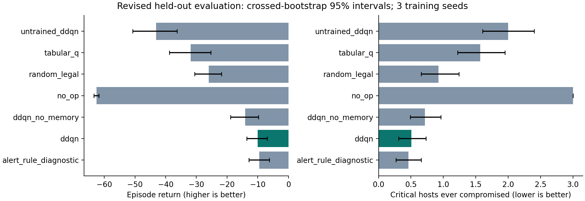
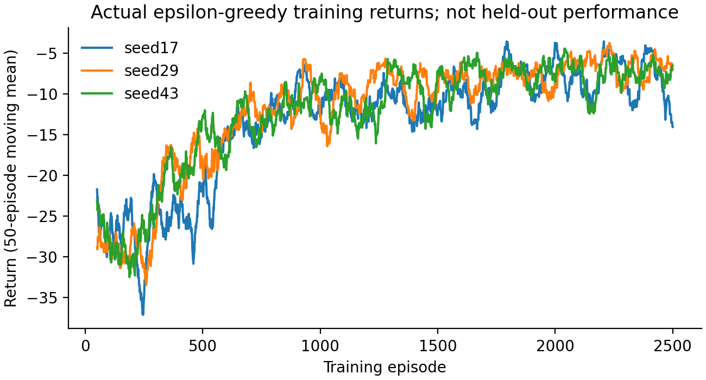

# SentinelRL — Budgeted Network Defence

**Rohit Mourya (B23ES1029) · Jyotiraditya Singh Rathore (B23ES1017)**  
[Original team repository](https://github.com/rohitkumarmourya-maker/SentinelRL)

A synthetic six-host network-defense POMDP with a genuine observation-only **Double DQN** agent. The defender learns to inspect, patch, isolate or deploy decoys using noisy alerts, inspection history and a six-token response budget.

**Completed:** trained checkpoints for three seeds, tabular Q-learning, a separately retrained no-memory ablation, initial-network controls, 8,400 held-out evaluation rows, raw training/update logs, uncertainty estimates and a two-page report. The user initially deferred model execution and then explicitly authorized it; the earlier pending-results ZIP/PDF are preserved separately. This package contains the actual completed run.

## Install, test and run the trained agent

Use Python 3.10–3.12; the recorded run used Python 3.12.5, PyTorch 2.8.0 and CPU. From the extracted `SentinelRL/` folder:

```sh
python3 -m venv .venv
source .venv/bin/activate
python -m pip install -r requirements.txt
python -m pytest -q
python demo.py --checkpoint models/ddqn_history_seed17.pt --execute-model-run
python scripts/verify_evidence.py --replay

# Optional: reevaluate bundled checkpoints into a fresh directory
python scripts/evaluate_pretrained.py --execute-model-run --output runs/pretrained-check
```

All **35 tests pass**, including real gradient updates, Double DQN targets, legal actions, checkpoint round-trip and simulator noninterference checks. The replay command verifies all raw evidence and exactly reproduces one saved held-out episode from the bundled checkpoint. No CUDA, credentials, external dataset, network service or Gym installation is needed. Windows activation is `.venv\Scripts\activate`. The original environment-only demo remains available as `python demo.py`; it is a fixed API exercise rather than a learned policy.

`requirements-tested.txt` records actual dependency versions. Installation in a new virtual environment was not repeated during this delivery. Keep `src/` unchanged when using the recorded checkpoints: evaluation verifies the exact training-source hash. An immutable duplicate is in `provenance/training-source/`.

## Measured results

All models use the prespecified final 2,500-episode checkpoints for seeds 17, 29 and 43. There was no test-set tuning or checkpoint selection. Primary evaluation uses 100 paired scenarios across policies and seed blocks.

| Policy | Mean return ↑ | Critical hosts compromised ↓ |
|---|---:|---:|
| Double DQN | **−10.04** [−13.60, −6.87] | **0.507** [0.310, 0.730] |
| Fixed alert rule, diagnostic control | −9.48 [−12.91, −6.24] | 0.460 [0.270, 0.660] |
| Retrained no-memory DDQN | −14.12 [−18.86, −9.77] | 0.717 [0.490, 0.963] |
| Random legal actions | −25.96 [−30.54, −21.83] | 0.927 [0.660, 1.240] |
| Tabular Q-learning | −31.88 [−38.78, −25.27] | 1.570 [1.220, 1.950] |
| Initial untrained network | −43.10 [−50.76, −36.29] | 2.000 [1.607, 2.400] |
| No action | −62.56 [−63.41, −61.72] | 3.000 [3.000, 3.000] |

Brackets are 95% crossed-bootstrap intervals over training-seed and paired-scenario axes; only three trained seeds limit inference. Deterministic controls have 100 unique scenarios repeated solely for pairing, not three independent trained copies. Raw per-seed results, SDs and paired differences are included.

The DQN learned: its paired return improvement over the initial network is **+33.06 [26.59, 39.99]**, and over the no-memory ablation is **+4.08 [0.99, 7.84]**. It did **not** establish superiority over the alert rule: difference **−0.56 [−4.70, 3.25]**. It also achieved only **2.64% explicit confirmation coverage**, versus 91.13% for the alert rule, with high censored confirmation delay (45.40 steps). It often contained suspected attackers without a successful diagnosis. Those are material limitations, not omitted failure cases.





The three DQN seeds took 44.95 seconds of logged training on an Apple M5 Max CPU (one PyTorch thread), with 360,000 transitions and 89,253 gradient updates. All nine training runs together used 1,080,000 transitions and 111.38 logged training seconds. These timings exclude evaluation, plotting and setup. `results/RUN_FACTS.json` gives exact values.

## Reproduce the full experiment

Use a fresh output directory to preserve the bundled evidence. Commands perform real model execution; the explicit flag prevents an accidental long run.

```sh
# Full protocol: DDQN + tabular Q-learning + retrained ablation + evaluations + plots
python run_all.py --execute-model-run --output runs/reproduction

# Or run stages individually into another fresh run directory
python train.py --execute-model-run --algorithm all --output runs/manual
python train.py --execute-model-run --algorithm ddqn --observation-mode no_memory --output runs/manual
python evaluate.py --execute-model-run --include-no-memory --output runs/manual
python evaluate.py --execute-model-run --include-no-memory --sensitivity --output runs/manual
python scripts/plot_results.py --output runs/manual
python scripts/verify_evidence.py --output runs/manual --replay
```

The recorded run used the full command with `--output runs/full_20261026`; its byte-identical artifacts are copied into the primary `models/` and `results/` folders to avoid duplicate archive contents. Checkpoints/episode/update logs/manifests are protected from overwrite. A failed/interrupted run needs a fresh output directory.

`config.json` is a readable snapshot of the frozen plan, **not a runtime configuration parser**. Authoritative defaults live in `src/environment.py`, `src/dqn.py` and `src/protocol.py`. The frozen protocol's historical `FROZEN_FUTURE_PROTOCOL` string is preserved inside checkpoint metadata; outer `execution_status: COMPLETE` and `results/STATUS.json` record actual execution. CLI options select episode count/seeds/ablation/output; any later tuning requires a separate validation split.

## Design, provenance and limitations

Observations have 56 values: nine defender-visible features per host and normalized budget/time. There are 25 actions. Attacks spread simultaneously over a fixed graph; patching and decoys retain nonzero risk. Reward balances critical losses, active unconfirmed compromise, intervention costs and clean-isolation downtime. Explicit confirmation earns a bonus at most once per host.

The revised DQN uses learned Q values alone, real PyTorch gradients and observable availability masks. It has no heuristic teacher, demonstrations, fixed Q prior or action shield. The original code exposed hidden infections indirectly and let a handcrafted prior dominate the network. Its incompatible source/checkpoints/results remain under `legacy/`, excluded from these performance claims.

The original five Git commits are preserved unchanged in `provenance/original-history.bundle`. No GitHub changes were pushed; no history or results were manufactured. The corrected current source and its actual run are directly included, with hashes. Read `docs/PROVENANCE.md`, `docs/PROJECT_DESIGN.md`, `docs/EXPERIMENT_PROTOCOL.md`, `docs/RESULTS_INTERPRETATION.md` and `docs/DEMO_AND_VIVA.md`. The report is `report/main.pdf` with editable sources alongside it.

This is a small stationary simulator, not a production cyber-defense claim. Low diagnostic coverage, a strong hand-written comparator, simplified patch/decoy costs, three seeds and a compressed feed-forward POMDP observation limit generalization. The separate sensor sweep is a robustness probe, not an alternative primary result chosen after seeing outcomes.
